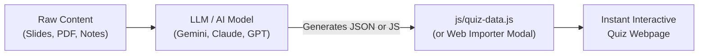

# QuizFramework - Complete Guide & AI Instruction Manual

Welcome to **QuizFramework**, an open, ultra-modern, glassmorphic interactive quiz platform designed specifically for seamless AI generation and human self-assessment.

---

## 1. Overview & Architecture

### Why QuizFramework?
Traditional quiz tools (such as NotebookLM, Wayground, or Google Forms) often restrict question formats, enforce rigid backend platforms, or lack modern visual design. **QuizFramework** is built on pure standard web technologies (**HTML5, CSS3, Vanilla JavaScript**) with zero external dependencies, offering:

- **100% Plug-and-Play Reusability:** Question content is strictly decoupled from presentation logic in `js/quiz-data.js`.
- **LaTeX Math Rendering (KaTeX):** Full native rendering of inline (`$formula$`) and display (`$$formula$$`) equations across question titles, options, and explanations.
- **Modern Glassmorphism Design:** Dark/Light theme support, frosted translucent glass panels, floating ambient radial orbs, and electric lime/cyan neon accents inspired by modern Web3 and Neomorphic design systems.
- **Support for Diverse Question Types:**
  1. **Single-Choice Questions:** Standard radio selection (1 correct answer out of $N$ choices).
  2. **Multi-Choice Questions (1 to $N$ answers):** Checkbox selection supporting any number of options $> 1$ and any combination of correct answers.
  3. **True / False Sets (`true_false`):** A cluster of $N$ statements where each can be independently toggled to True or False (or Đúng / Sai). Full credit requires 100% of statements to be correctly toggled.
  4. **Essay / Open-Ended Questions:** Free text input with instant reveal of the **Model Answer** and a **Key Rubric Checklist**, followed by intuitive user self-grading.
- **Rich Text & Math Formatting:** Native Markdown (`**bold**`, `*italic*`, `` `code` ``, `~~strikethrough~~`) combined with KaTeX LaTeX math notation (`$P = 10$`, `$$...$$`).
- **Immediate Feedback & Explanations:** Real-time answer validation upon clicking **Check Answer** or via **Instant Answer Checking** mode in Settings. Clean borders and colors convey correctness without cluttering text.
- **Keyboard Shortcuts:** Select options via `A, B, C, D, E` or `1, 2, 3, 4`, navigate with `ArrowLeft / ArrowRight`, submit with `Enter`, bookmark with `F`, and import quizzes instantly with `Enter` or `Spacebar` in the import modal.
- **Time Pressure Challenge Mode:** Optional per-question countdown timer. Questions are automatically marked incorrect if time expires without the right answer. Enabling or disabling resets the quiz from question 1 with confirmation prompts. Includes dynamic difficulty warnings based on AI-calibrated reading times.
- **Quality Assurance & Benchmark Suite:** Built-in psychometric and structural benchmark (`test/quiz-benchmark.js`) scoring AI-generated quizzes across 6 pedagogical dimensions.
- **Flag & Bookmark System:** Mark tricky questions with a flag to review them later in the sidebar and summary.
- **Expandable / Collapsible Sidebar:** Live question matrix (1 to $N$), current question highlighter, and answered status badges.
- **Comprehensive Summary Page:** Full percentage calculations (right/wrong ratio), accuracy gauge, breakdown metrics, and an interactive review grid to jump directly back to any question. The live timer automatically stops upon completing all questions.
- **Built-in AI JSON Importer:** Paste question JSON generated by any AI directly inside the web interface without touching code.

---

## 2. File & Directory Structure

```text
QuizFramework/
├── index.html            # Main web application shell
├── INSTRUCTION.md        # This comprehensive guide and AI prompting manual
├── css/
│   ├── glassmorphism.css # Frosted glass variables, blurs, and neon utilities
│   └── style.css         # Complete responsive styles, themes, and layout
├── js/
│   ├── theme.js          # Dark/Light theme manager (modern-web-guidance compliant)
│   ├── quiz-data.js      # ★ THE ONLY FILE AI OR USERS NEED TO EDIT!
│   └── quiz-engine.js    # Stateful quiz runner, validation logic, and summary
└── test/
    └── quiz-engine.test.js # Automated verification test suite
```

---

## 3. Plug-and-Play User Flow



1. **Step 1:** The user takes their lecture slides, notes, or textbook chapter.
2. **Step 2:** The user copy-pastes the **AI Prompt Template** (provided in Section 5 below) into an AI model along with their content.
3. **Step 3:** The AI outputs the formatted `quiz-data.js` code.
4. **Step 4:** The user saves the code into `js/quiz-data.js` (or clicks **"Import Quiz"** in the top navigation bar and pastes it).
5. **Step 5:** Open `index.html` in any browser — your custom quiz is live!

---

## 4. Question Data Schema Reference

The data file `js/quiz-data.js` exposes two global objects: `window.QUIZ_CONFIG` and `window.QUIZ_QUESTIONS`.

### 4.1. Configuration Schema (`QUIZ_CONFIG`)
```javascript
window.QUIZ_CONFIG = {
  title: "Macroeconomics: Money & Banking", // Short title (2-5 words)
  category: "Economics",
  author: "Professor Smith",
  timeLimitMinutes: 0,   // 0 = untimed, or specify minutes (e.g., 20)
  defaultQuestionTime: 25, // Default seconds per question for Time Pressure
  passingScore: 70,       // Minimum passing percentage (e.g., 70%)
  shuffleQuestions: false,
  shuffleOptions: false
};
```

---

### 4.2. Question Types & Examples

#### Type 1: Single-Choice Question (`type: "single"`)
```javascript
{
  id: 1,
  type: "single",
  estimatedTime: 22, // Estimated minimum seconds: stem reading time + 2s/option + calculations
  question: "What happens to the equilibrium price of coffee if the supply decreases while demand remains constant?",
  code: null, // Optional code snippet or null
  options: [
    "Equilibrium price increases and quantity decreases",
    "Equilibrium price decreases and quantity increases",
    "Both price and quantity remain unchanged",
    "Price decreases and quantity decreases"
  ],
  correct: 0, // 0-indexed number of the correct option
  explanation: "A decrease in supply shifts the supply curve leftward. Along a stationary downward-sloping demand curve, this results in a higher equilibrium price and a lower equilibrium quantity."
}
```

#### Type 2: Multi-Choice Question (`type: "multiple"`)
Supports 1 to $N$ correct answers and any number of options $> 1$:
```javascript
{
  id: 2,
  type: "multiple",
  question: "Which of the following are examples of expansionary fiscal policy? (Select all that apply)",
  options: [
    "Cutting personal income taxes",
    "Increasing government defense spending",
    "Raising corporate income tax rates",
    "Funding nationwide infrastructure projects",
    "Selling government bonds in open market operations"
  ],
  correct: [0, 1, 3], // Array of 0-indexed correct options
  explanation: "Expansionary fiscal policy involves increasing government purchases or reducing taxes to stimulate aggregate demand. Selling bonds is a monetary policy action."
}
```

#### Type 3: True / False Statements Set (`type: "true_false"` or `type: "tf"`)
A set of statements where each statement has an independent True/False toggle. The question is marked correct if and only if all statements are toggled correctly:
```javascript
{
  id: 3,
  type: "true_false",
  question: "Evaluate whether each of the following statements regarding **Microeconomics** is **True** or **False**:",
  statements: [
    {
      text: "A binding price ceiling set below equilibrium ($P_{max} < P_e$) causes a persistent market **shortage**.",
      correct: true
    },
    {
      text: "In the short run, a perfectly competitive firm shuts down immediately whenever price $P < ATC$.",
      correct: false
    },
    {
      text: "Inferior goods possess a negative income elasticity of demand ($E_I < 0$).",
      correct: true
    }
  ],
  explanation: "1. True: Low price caps increase quantity demanded while discouraging supply, causing a shortage.\n2. False: In the short run, a firm produces as long as $P \\ge AVC$; it shuts down only if $P < AVC$.\n3. True: By definition, higher income decreases consumption of inferior goods ($E_I < 0$)."
}
```

#### Type 4: Essay / Open-Ended Question (`type: "essay"`)
Free text input with model answer and rubric self-evaluation:
```javascript
{
  id: 3,
  type: "essay",
  question: "Compare and contrast a Monopolistically Competitive market with a Perfectly Competitive market. Highlight at least two similarities and two key differences.",
  hint: "Think about barrier to entry, number of firms, product differentiation, and pricing power.",
  modelAnswer: "Similarities:\n1. Both markets feature a large number of buyers and sellers.\n2. Both markets have low barriers to entry and exit, leading to zero economic profits in the long run.\n\nDifferences:\n1. Perfect competition features homogeneous (identical) products, whereas monopolistic competition offers differentiated products.\n2. Perfectly competitive firms are price takers (P = MR = MC), whereas monopolistically competitive firms have downward-sloping demand curves and some pricing power (P > MC).",
  keyPoints: [
    "Identifies at least two similarities (many firms, free entry/exit, long-run zero profit).",
    "Identifies product differentiation in monopolistic competition vs identical goods in perfect competition.",
    "Explains pricing power difference (price takers vs downward-sloping demand)."
  ],
  explanation: "Product differentiation gives monopolistically competitive firms downward-sloping demand curves, resulting in excess capacity in the long run."
}
```

---

## 5. Master Prompt Templates for AI Models

When asking an AI model (ChatGPT, Claude, Gemini, or Antigravity) to create a quiz from your notes, slides, or documents, copy and paste this exact prompt:

```markdown
You are an expert educational content creator. I want you to create an interactive quiz using the QuizFramework schema.

### Instructions:
1. Carefully study the attached study notes/content: [PASTE YOUR CONTENT HERE]
2. Create a comprehensive quiz covering all key concepts.
3. Question Format:
   - **Default:** Standard 4-choice single-answer multiple choice questions (1 correct option out of 4 choices A, B, C, D). Do NOT generate other formats unless explicitly requested.
   - **Optional (only when requested):** Multi-choice, True/False sets, or Essay / conceptual questions.
4. Output your response as a valid JavaScript file (or pure JSON) that defines `window.QUIZ_CONFIG` and `window.QUIZ_QUESTIONS`.
5. Ensure every question includes an insightful `explanation` explaining why the correct answers are right and why common distractors are wrong.
6. Adhere strictly to the rules: short title (2-5 words), NO subtitle, NO category field inside individual questions, shuffled question sequencing, balanced option length (no longest-option bias), and strict zero-errata (fix root questions directly, never append errata in explanations).

### Output Format:
```javascript
window.QUIZ_CONFIG = {
  title: "Your Short Title Here",
  category: "Your Subject",
  passingScore: 70,
  timeLimitMinutes: 0
};

window.QUIZ_QUESTIONS = [
  // Question objects following the QuizFramework schema...
];
```
```

---

## 6. How to Run, Test, and Deploy

### Local Execution (Immediate, Zero Install)
Because QuizFramework uses standard browser ES6 APIs:
- Simply **double-click `index.html`** in your file manager to open it in Chrome, Safari, Firefox, or Edge.
- No build step, no npm install, no bundlers required!

### Running with a Local Server
If you prefer running via a local HTTP server:
```bash
# Using Python 3
python3 -m http.server 8000

# Or using Node.js
npx serve .
```
Then navigate to `http://localhost:8000`.

### Deploying Online (Free & Instant)
- **GitHub Pages:** Push the `QuizFramework` folder to a repository, go to **Settings > Pages**, and choose the main branch.
- **Vercel / Netlify:** Drag-and-drop the `QuizFramework` folder into the Netlify or Vercel dashboard for an instant HTTPS URL.

---

## 7. Keyboard Shortcuts

| Key | Context | Action |
| :---: | :---: | :--- |
| `1` - `9` or `A` - `I` | Main Quiz | Select or toggle Option 1 through Option 9 (or Option A through I) |
| `Enter` | Main Quiz | Check current question answer |
| `←` (Left Arrow) | Main Quiz | Navigate to Previous Question |
| `→` (Right Arrow) | Main Quiz | Navigate to Next Question |
| `F` | Main Quiz | Toggle Flag / Bookmark on the current question |
| `Enter` or `Space` | Import Menu | **Import quiz & start immediately** (or `Ctrl+Enter` while editing textarea) |
| `Escape` | Modals | Close Import Modal or Settings Modal |

---

## 8. Time Pressure & Estimated Time Calibration

QuizFramework features an advanced **Time Pressure Mode** configured in Settings:
- **Fixed Countdown per Question:** User defines seconds per question ($> 0$).
- **Strict Scoring Penalty:** When the timer runs out on a question, it is marked incorrect if unanswered or incorrectly selected.
- **Enabling / Disabling Reset:** Turning Time Pressure ON or OFF resets the quiz from Question 1 to maintain competitive integrity, protected with acceptance confirmation prompts.
- **AI-Calibrated Default Pace:** AI models compute `estimatedTime` per question using the formula:
  $$\text{estimatedTime} = \max\left(10, \left\lceil \frac{\text{Stem Words}}{3} \right\rceil + (2\text{s} \times \text{Options}) + \text{Bonus}\right)$$
- **Difficulty Feedback:** If the user sets a custom time:
  - Setting lower than estimated shows a warning: *"Much harder!"*
  - Setting higher than estimated shows an informational note: *"Not as challenging."*

---

## 9. Quality Assurance & Benchmark Suite

QuizFramework includes an automated benchmark suite (`test/quiz-benchmark.js`) to objectively evaluate AI-generated quizzes across 6 quality dimensions:
1. **Structure & Schema (20 pts):** Short titles (2-5 words), no deprecated subtitle, no category in questions.
2. **Time Pressure Calibration (15 pts):** Presence of `estimatedTime` conforming to reading speed + 2s/option.
3. **Distractor Quality & Length Parity (20 pts):** Longest-option bias test and duplicate option prevention.
4. **Pedagogical Independence & Zero-Errata (20 pts):** Self-contained questions (no slide meta-references) and zero-errata compliance.
5. **Explanation Depth & KaTeX Math (15 pts):** Thorough explanations and valid LaTeX math tokens.
6. **Balance & Diversity (10 pts):** Standard 4 options and balanced answer key distribution.

### Running the QA Benchmark:
```bash
# Evaluate a custom quiz file
node test/quiz-benchmark.js path/to/quiz.json

# Run benchmark on default datasets and test detection suite
node test/quiz-benchmark.js
```

### Running the Unit Test Suite:
```bash
node test/quiz-engine.test.js
```
